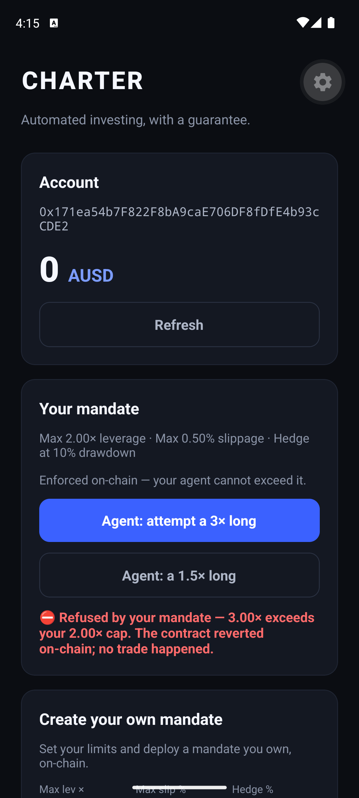
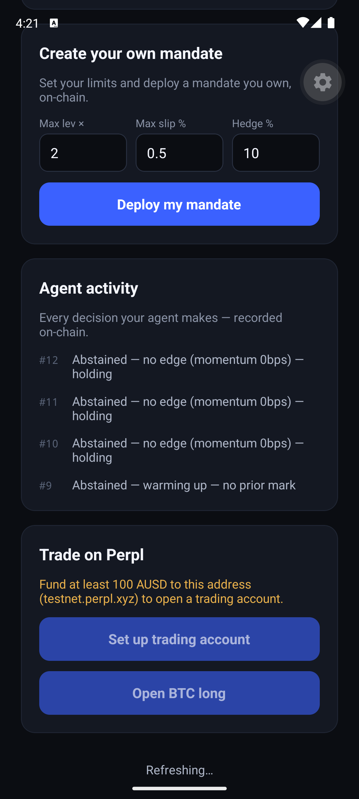
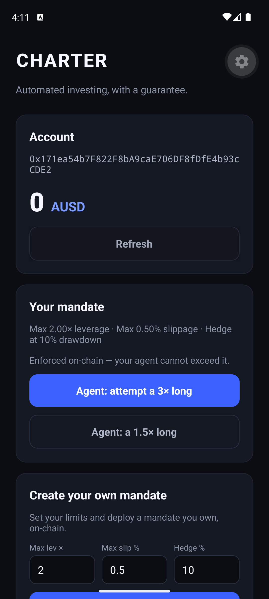
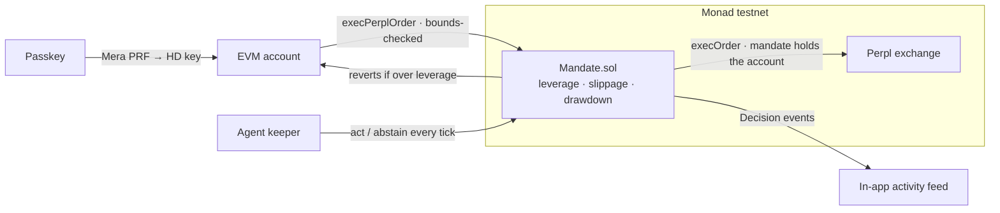

# Charter

**Automated investing is a promise. Charter makes it a _guarantee_.**

Charter is a mobile app where an autonomous agent manages a position on **Monad**, bound by a rule it
**cannot break**. You set a mandate once — _never above 2× leverage · never more than 0.5% slippage ·
hedge if drawdown exceeds 10%_ — and it lives in a **contract, not a prompt**. When the agent tries to
exceed the bound, the contract reverts. No seed phrase, no extension, no custody backend: your account
is a **passkey**.

<p align="center">
  
  &nbsp;
  
  &nbsp;
  
</p>

> The money shot (left): the agent proposes a 3× long; the mandate reverts on-chain — **no trade happens.**

Built for the **Monad Metropolis Hackathon** — Track 01, Onchain Finance & Trading.

---

## What it does

- **Passkey sign-in (Mera).** Your account is a passkey — no seed phrase, no browser extension, no
  custody backend. One Face-ID/biometric and you have an EVM account on Monad.
- **Your mandate, enforced on-chain.** Max leverage, max slippage, drawdown trigger — in a contract.
  The agent proposes a trade; a reckless **3× long is refused** (the contract reverts); a 1.5× is allowed.
- **An autonomous agent, not a button.** A keeper reads a live market signal each tick and writes its
  decision on-chain — `act(Hedge|Rebalance)` or `abstain(reason)` — and the mandate blocks any breach.
- **Live Activity feed.** Every decision the agent makes (including every decision to do nothing) is a
  public `Decision` event, shown in-app.
- **Proof-of-performance.** A provable track record: how many decisions the agent made and that it
  **never once breached your limits** — read straight from the on-chain log, not a self-reported number.
- **Real Perpl trade, through your mandate.** Set up a trading account the mandate custodies, then open a
  long or short on BTC/ETH/SOL/MON/ZEC — a real on-chain `execOrder` the mandate sends via `execPerplOrder`,
  with leverage capped on-chain. An order above your limit reverts before any funds move.
- **Portfolio, read on-chain.** Account value, unrealized PnL, open positions — read straight from Perpl's
  contracts (the mandate is the account holder), not a self-reported number.
- **Deploy your own mandate, and stay in control.** Deploy a mandate _you own_ on-chain, then **pause
  the agent instantly** (a kill switch) or adjust your limits live — all owner-only, enforced on-chain.

## How it works



The mandate is the trust primitive: it **custodies the collateral and holds the Perpl account**, and
both the agent and the owner can only trade through `execPerplOrder`, which caps leverage on-chain. A
compromised or buggy agent still can't exceed your limits — the order reverts before any funds move.

## Proven on-chain — don't trust, verify

All on **Monad testnet** (chainId 10143, [explorer](https://testnet.monadexplorer.com)):

- **Mandate** (agent-operated): [`0x564EFe…A648`](https://testnet.monadexplorer.com/address/0x564EFe00cfF81eaF6A65422758C27A0c89EAA648)
  — every `Decision` event is an agent move; a 3× proposal reverts `LeverageExceeded` (`0x6881ba1f`).
- **Perpl exchange:** [`0x1964…80cc`](https://testnet.monadexplorer.com/address/0x1964C32f0bE608E7D29302AFF5E61268E72080cc)
  — real `execOrder` perp trades on Monad; in the custody build the mandate holds the Perpl account and sends
  every order through `execPerplOrder` (leverage capped on-chain).
- Full deployment + evidence: [`deployments/monad-testnet.json`](deployments/monad-testnet.json).

The custody enforcement — a breach reverts a _real_ trade, not just a log — is implemented and unit-tested
in [`test/MandateExecution.t.sol`](test/MandateExecution.t.sol): both the spot path (`executeSwap` reverts
when the fill breaches the slippage floor) and the perp path (`execPerplOrder` reverts `LeverageExceeded`
before the order is sent). The kill switch and live limit-tightening are tested too — 19/19 pass.

## Built on — and the bounties it targets

| Integration | What Charter uses it for | Bounty |
| --- | --- | --- |
| **Mera** | passkey → EVM account, no seed/extension/backend | Monad "Best Mera-Powered UX" |
| **Perpl** | real perp trades (`execOrder`) + on-chain account/position reads | "Best use of Perpl's API" |
| **The Mandate** | on-chain leverage/slippage/drawdown enforcement + auto-hedge | **Perpl "Best Analytics / Risk Tool"** |
| **AUSD** (Agora) | the displayed balance _and_ Perpl collateral (one token) | Agora "Best Mobile Trading App" |
| **Monad** | per-block agent decisions, fully on-chain | Track 01, Onchain Finance & Trading |

## Try it

- **Install the APK** (Android 13+): see [Releases](https://github.com/Charter-org/charter/releases).
  Passkey sign-in + the Mandate refusal work with zero funding; the Perpl trade needs testnet MON
  (`faucet.monad.xyz`) + AUSD.
- **Run from source:** `app/` is an Expo app ([app/README.md](app/README.md)); `keeper/` is the agent
  loop ([keeper/README.md](keeper/README.md)); contracts are Foundry (`forge test`).

## Repo layout

```
src/            Mandate.sol — the on-chain guarantee (+ interfaces)
test/           Foundry tests (incl. the custody slippage-floor refusal)
keeper/         autonomous agent loop (reads signal → decides → on-chain)
app/            Expo mobile app (Mera passkey, mandate, Perpl, portfolio)
config/         verified Monad + Perpl/Kuru/AUSD constants
deployments/    live addresses + on-chain evidence
```

## Tech

Solidity / Foundry · Monad testnet · Expo / React Native · viem · Mera (passkey accounts) ·
Perpl REST/WS (Ed25519-signed) · AUSD (Agora).

## AI tool disclosure

Built with AI coding assistance (Claude Code). Per hackathon rules, AI tool use is permitted and
disclosed here. Human authors direct the design, review all code, and own the submission.

## License

MIT — see [LICENSE](LICENSE).
